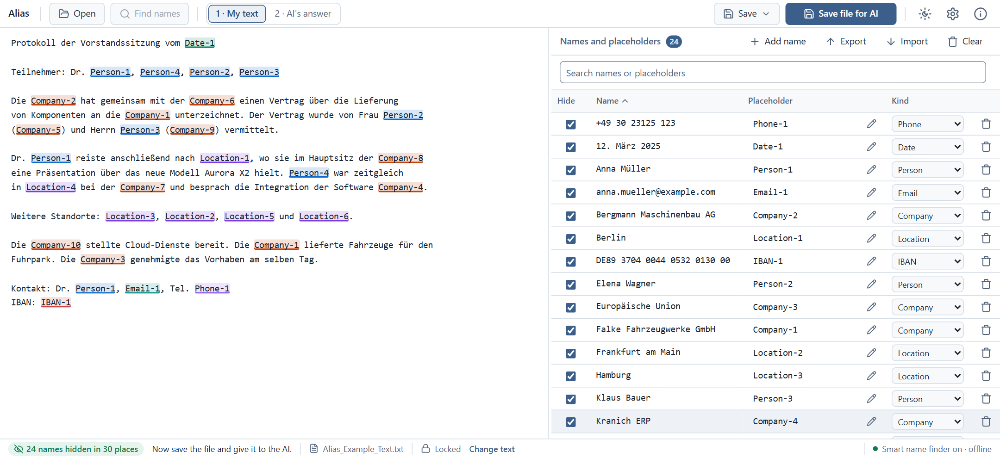

#  Alias

**Pseudonymize texts and documents before they go to an AI – in one HTML file, on your computer.**

Alias finds names, companies, addresses, e-mail addresses, IBANs, phone numbers and more, with simple rules and, if you turn it on, a small AI that runs on your computer. It hides them behind placeholders such as `Person-1` before you hand a text to an AI tool, and brings the real names back into the AI's answer. Everything runs in the browser; documents never leave your computer.

  

## What it does

- **One button for the next step** – Open file, Find names, Hide names, Copy for AI, Paste AI's answer, Bring names back, Copy; with a file: Save file for AI, Open AI's file, Bring names back, Save file. The status bar says in one sentence what happened and what comes next.
- **Files go both ways** – give the AI a Word or Excel file with placeholders, open the file it sends back (for example with the spelling fixed) and save it with the real names, in the same format.
- **Find names** – simple rules, and the smart name finder if you turn it on, suggest what to hide; you tick, correct or drop each name in a list grouped by kind.
- **Hide names and bring them back** – every ticked name becomes its placeholder, in any capitalization and only as a whole word; the AI's answer gets the real names back the same way.
- **Office, PDF and text files** – Word, Excel, PowerPoint, OpenDocument and many text formats are saved in the same format, with placeholders for the AI and with the real names after the AI; PDF and `.xls` as text. Details in [`docs/FILE-FORMATS.md`](docs/FILE-FORMATS.md).
- **Clean copies** – an encoded Office copy also loses author, company, dates, comment authors, thumbnail and similar metadata; Alias lists what it removed.
- **Names and placeholders** – search, sort, change placeholders, untick names, undo a delete; export and import as JSON.

## Start

On Windows, use the installer: download `alias_<version>_windows-installer.zip` from [Releases](https://github.com/fly2nbc-oss/Alias/releases), unpack it and run `install.cmd`. It installs for the current user without admin rights, adds *Alias* to the Start menu, opening in its own Edge window, and adds an entry to *Settings > Apps*. The script is not signed, so Windows may ask whether to run it (*More info > Run anyway*).

With Edge installed, Alias runs there with **its own Edge profile** in `%LOCALAPPDATA%\AliasData\EdgeProfile`. The list of names and the smart name finder live in it, apart from your normal browser: in a normal browser profile all HTML files opened from disk share one storage, so another local file could read the list of names.

- **Update** – run `install.cmd` of the new version. The list of names is kept.
- **Uninstall** – *Settings > Apps > Alias* removes the app and keeps the list of names and the smart name finder. `uninstall.cmd` in `%LOCALAPPDATA%\Programs\Alias` asks whether to delete them too; `uninstall.cmd /purge` deletes them without asking.
- **From the desktop app (Alias 1.1 and older)** – uninstall it first; `install.cmd` stops otherwise. Its alias table is not taken over automatically: load `alias_store.json` from the old app's data folder in `%APPDATA%` with **Import** above the list of names.
- `install.cmd /quiet` skips the pause at the end, for software distribution.

Without the installer, download `alias.html` and open it in Edge or Chrome, or put it on a web server. Firefox and Safari are not tested.

Press the blue button at the top right; it always names the next step (`Ctrl+Enter`).

**A file through an AI and back** – for example a Word or Excel file the AI should check for spelling:

1. **Open file**, **Find names**, tick what to hide, **Hide names**.
2. **Save file for AI** saves `Report_anonym.docx` with placeholders such as `Person-1`. Give this file to the AI.
3. **Open AI's file** and choose the file the AI sent back. Alias shows its text with the placeholders marked.
4. **Bring names back**, then **Save file**: `Report_original.docx` has the real names again and keeps the AI's changes.

The AI must leave the placeholders as they are. Small or capital letters do not matter; if the AI wrote one differently (`Person 1` instead of `Person-1`), the status bar says how many placeholders were not replaced, so you can fix them by hand.

| Step | How |
|---|---|
| Open a text | **Open file** (`Ctrl+O`), drop a file on the window, or paste text into *1 · My text* |
| Find names | **Find names** (`Ctrl+Shift+D`); tick the names to hide, then **Use these names**. `Esc` stops a long run |
| Hide names | **Hide names** (`Ctrl+Shift+E`), then **Copy for AI** for a text, or **Save file for AI** for a file (a copy with placeholders, `…_anonym.docx`). *Save ▾* also copies or saves the text |
| Bring names back | **Paste AI's answer** opens *2 · AI's answer*, then **Bring names back** (`Ctrl+Shift+U`) and **Copy** or *Save ▾* |
| Bring names back into a file | **Open AI's file** (`Ctrl+O` in step 2, or drop the file there) opens the file the AI sent back, in any format Alias reads. **Bring names back**, then **Save file** saves it with the real names in its format (`…_original.docx`) |
| Settings | Gear icon: appearance, smart name finder, update check |

On the first start Alias asks about two things that use the internet, both off unless you tick them: the **smart name finder** (a small AI, downloaded once from Hugging Face, about 180 MB) and the weekly **update check**. Without them Alias works fully with simple rules; you can turn them on later in Settings or with **Turn on** in the status bar.

**Check before sharing**: Alias hides the names in the text it shows you, but it cannot see text inside images (no OCR), only reports OLE objects and macros, does not accept tracked changes (their text is hidden too) and does not rename OpenDocument sheet names. Legacy `.doc`/`.ppt` and password-protected files cannot be opened.

## Your data and privacy

The list of names and placeholders holds your real names. The browser keeps it, with the settings and the smart name finder, until you clear the site data, delete the download in Settings or uninstall with `/purge`. Treat exported lists like the documents themselves.

This program will not transfer any information to other networked systems unless specifically requested by the user or the person installing or operating it. Only if you turn them on, Alias connects to `huggingface.co` once to download the smart name finder (pinned to a fixed version and checked file by file) and, once a week, to `api.github.com` to see whether there is a newer release. It never sends documents, text or telemetry. [`SECURITY.md`](./SECURITY.md) has the details.

## More

- Building from source: [`CONTRIBUTING.md`](./CONTRIBUTING.md) · Changes: [`CHANGELOG.md`](./CHANGELOG.md) · Security: [`SECURITY.md`](./SECURITY.md)
- License: Apache 2.0 ([`LICENSE`](./LICENSE)), third-party components and the AI model in [`THIRD_PARTY.md`](./THIRD_PARTY.md)

Microsoft Word, Excel, PowerPoint and Edge are trademarks of Microsoft Corporation, named only to describe file and browser compatibility; this project is not affiliated with Microsoft.
